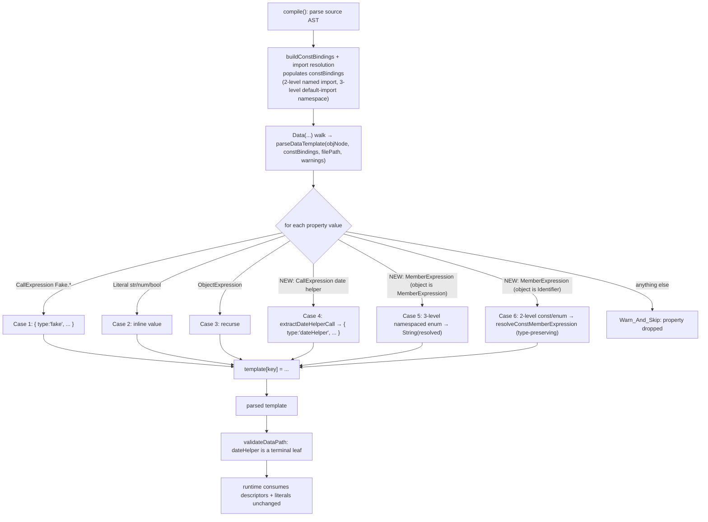

# Design Document

## Overview

This feature closes a compile-time parsing gap in the Tomation DSL compiler. The
function `parseDataTemplate` (in `packages/compiler/src/parser.js`) converts the
`Data({...})` object expression into a parsed template. Today it recognizes
exactly three property value shapes — `Fake.*(...)` calls, static literals, and
nested object expressions — and silently drops every other shape. As a result,
two author-facing value shapes never reach the parsed template:

1. **Enum / const member references**, both the three-level namespaced form
   `NewTaskPage.TaskTypes.AUTHORIZATION_REQUEST` (a `MemberExpression` whose
   object is itself a `MemberExpression`) and the two-level form `TaskTypes.KEY`
   (named import of a POM enum) or `SomeConst.MEMBER` (local/imported const).
2. **Date-helper calls** such as `nextWeek('MM/DD/YYYY')`, `today()`,
   `tomorrow()`, or `firstDateOfMonth(0)`.

When a test later references a dropped property (for example `newTask.taskType`),
`validateDataPath` cannot find the key, emits an "Unknown data path" warning, and
the compiled spec is missing the field.

The fix is deliberately narrow. It adds explicit cases to `parseDataTemplate`
(after the existing Case 3) that accept **only** date-helper call expressions and
enum / const member references, reusing machinery that already exists in the
parser:

- `extractDateHelperCall` — already produces the correct
  `{ type: 'dateHelper', ... }` descriptors.
- The three-level namespaced-enum resolution logic that already exists inside
  `extractValueExpression`.
- `resolveConstMemberExpression` — the type-preserving two-level resolver.

It also makes one small change to `validateDataPath` so a
`{ type: 'dateHelper' }` descriptor is treated as a terminal leaf (like `Fake.*`
nodes and static literals).

### Scope and non-goals

- **In scope:** `parseDataTemplate` (new value cases) and `validateDataPath`
  (terminal-leaf guard) — both in `packages/compiler/src/parser.js`.
- **Out of scope:** No runtime change. The runtime already resolves
  `{ type: 'dateHelper', ... }` descriptors and literal values; the descriptors
  and literals produced here are structurally identical to what the runtime
  already consumes (Req 7 criterion 4).
- **Out of scope:** No change to import resolution — `constBindings` is already
  populated for both import styles before `parseDataTemplate` runs
  (parser.js ~L4120–4175).
- **Out of scope:** No DSL type-definition changes — enums/const and date helpers
  are already valid author syntax in other value positions.
- **Out of scope:** The inline-test-data spec is not modified. This is a separate,
  scoped extension spec.

## Architecture

The change touches a single file and two functions. The data flow around the
`Data(...)` walk is unchanged except for the new value cases.



### Why reuse, not re-implement

`extractDateHelperCall`, the three-level namespaced-enum branch, and
`resolveConstMemberExpression` already encode the exact resolution and warning
behavior required. Reusing them guarantees the descriptors produced inside a
`Data` template are identical to those produced in every other value position
(Property P1, P2, P4) and avoids divergence.

### Why NOT reuse `extractValueExpression` wholesale (Req 5)

The general value extractor `extractValueExpression` is attractive because it
already contains the three-level enum branch and the two-level const branch.
But it **also** turns a bare `Identifier` into a `{{name}}` Param_Token and a
data-var member chain into a `{{data...}}` Data_Var_Token. Inside a
`Data({...})` template those interpretations are wrong — a `Data` template's
values are literal data, not params or data-var references. Calling it wholesale
would corrupt literal data into `{{...}}` tokens.

Therefore the design adds **narrow, explicit cases** that accept only:

- (a) date-helper `CallExpression`s (via `extractDateHelperCall`),
- (b) three-level namespaced-enum `MemberExpression`s (object is a
  `MemberExpression`),
- (c) two-level const/enum `MemberExpression`s (object is an `Identifier`, via
  `resolveConstMemberExpression`).

Every other shape — including bare identifiers and unsupported member chains —
falls through to Warn_And_Skip. No Param_Token or Data_Var_Token is ever emitted
from `parseDataTemplate`.

## Components and Interfaces

All components already exist. No new function is introduced; the only new code is
the set of cases inside `parseDataTemplate` and one predicate tweak in
`validateDataPath`.

### `parseDataTemplate(objNode, constBindings, filePath, warnings)` (parser.js ~L527)

Iterates the properties of the `Data({...})` `ObjectExpression`. Each property
value is matched against cases in order; the first match assigns
`template[key]` and ends the iteration for that property (`continue`). The
existing Case 1–3 are unchanged and run first (backward compatibility, Req 7).

New cases are inserted **after Case 3**, in this precise order:

1. **Case 4 — Date-helper `CallExpression`.** If `value.type === 'CallExpression'`
   and `extractDateHelperCall(value, filePath, warnings)` returns a non-null
   descriptor, assign it and `continue`. (Case 1 — `Fake.*` — is a
   `CallExpression` whose callee is a `MemberExpression`, and already matched
   earlier; date helpers are `CallExpression`s whose callee is a plain
   `Identifier`, so the two never collide.)
2. **Case 5 — Three-level namespaced-enum `MemberExpression`.** If
   `value.type === 'MemberExpression'` **and** `value.object.type === 'MemberExpression'`,
   resolve against `constBindings[nsName][enumName][memberKey]` using the same
   logic as the existing `extractValueExpression` three-level branch, and assign
   the `String()`-coerced resolved value.
3. **Case 6 — Two-level const/enum `MemberExpression`.** If
   `value.type === 'MemberExpression'` **and** `value.object.type === 'Identifier'`,
   call `resolveConstMemberExpression(value, constBindings, filePath, warnings)`;
   if it returns a non-null value (string/number/boolean), assign it
   **with its original primitive type preserved**.

Anything that does not match falls through to the end of the loop with no
assignment (Warn_And_Skip — the property is dropped).

#### Why three-level is checked before two-level (shape disambiguation)

The two shapes are distinguished by the type of `value.object`:

- Three-level `Namespace.Enum.KEY` → `value.object` is a `MemberExpression`.
- Two-level `Const.MEMBER` → `value.object` is an `Identifier`.

These are mutually exclusive on `value.object.type`, so order does not cause a
*mismatch*. Checking the three-level (more specific, nested) shape first is the
clearest and safest ordering: it mirrors the existing ordering inside
`extractValueExpression` (three-level branch precedes the two-level branch) and
prevents any future two-level predicate loosening from accidentally swallowing a
nested member expression.

#### Type-preservation difference (Req 1 vs Req 2)

This is a deliberate, requirement-driven asymmetry:

- **Two-level (Case 6, Req 2 criterion 1):** uses
  `resolveConstMemberExpression`, which returns the bound value **without
  coercion** — a number stays a number, a boolean stays a boolean. The stored
  value preserves its original primitive type.
- **Three-level (Case 5, Req 1 criterion 1):** uses the existing
  `extractValueExpression` namespaced lookup, which returns
  `String(constBindings[ns][enum][key])`. The stored value is the
  **string representation**.

The asymmetry is intentional and matches the requirements exactly: Requirement 1
specifies string-coerced storage for three-level references; Requirement 2
specifies type-preserved storage for two-level references. The design calls this
out explicitly so the implementer does not "normalize" the two paths.

#### Warning / skip behavior reused from existing helpers

- Case 4 (date helper): `extractDateHelperCall` already pushes warnings for
  too-many-args, non-string format, missing/invalid month offset, etc.
  (Req 3, Req 4). The descriptor is still returned and stored in those cases, so
  the property is not dropped — matching the requirement that a warning is
  recorded but the descriptor derived from valid args is stored.
- Case 5 (three-level): on a missing member or non-string computed key, the
  resolution returns null → Warn_And_Skip with a single warning identifying the
  unresolved property; the property is dropped (Req 1 criteria 3–4, Req 5
  criterion 3).
- Case 6 (two-level): `resolveConstMemberExpression` pushes exactly one
  "Unknown property" warning when the object is a known binding but the member is
  missing (Req 2 criterion 2), and returns null **without** a warning when the
  object identifier is not a known binding (Req 2 criterion 3). In both null
  cases the property is dropped.
- No shape ever throws. `parseDataTemplate` continues to the next property
  (Req 7 criterion 3).

### `validateDataPath(entry, path, filePath, line, warnings)` (parser.js ~L1327)

Walks the parsed template segment by segment. To descend to the next segment,
`current` must be a plain object that owns the segment. A `Fake.*` node and a
static literal are already terminal leaves. The change adds date-helper
descriptors to the set of terminal leaves by extending the `isPlainObject`
predicate to also exclude `current.type === 'dateHelper'`:

```js
var isPlainObject =
  current !== null &&
  typeof current === 'object' &&
  current.type !== 'fake' &&
  current.type !== 'dateHelper';
```

Effect (Req 6):
- A path ending at a date-helper descriptor is valid — no warning (the loop
  finishes without descending). (Req 6 criterion 1)
- A path with an extra segment after a date-helper descriptor fails the
  `isPlainObject` guard and the existing warn-and-return emits exactly one
  "Unknown data path" warning, then stops. (Req 6 criterion 2)
- The warning is warn-only; the surrounding caller still emits the data reference
  token unchanged and compilation is not blocked. (Req 6 criterion 3)

## Data Models

### Parsed template entry (output of `parseDataTemplate`)

A parsed template is a plain object mapping each property key to one of:

| Shape | Produced by | Example stored value |
| --- | --- | --- |
| `fake` descriptor | Case 1 (existing) | `{ type: 'fake', method: 'firstName', options: {} }` |
| static literal | Case 2 (existing) | `'Provider1'`, `42`, `true` |
| nested template | Case 3 (existing) | `{ ...nested keys... }` |
| day-offset descriptor | Case 4 (new) | `{ type: 'dateHelper', kind: 'dayOffset', offset: 7, format: 'MM/DD/YYYY' }` |
| month-boundary descriptor | Case 4 (new) | `{ type: 'dateHelper', kind: 'monthBoundary', boundary: 'first', monthOffset: 0 }` |
| string-coerced enum value | Case 5 (new, 3-level) | `'AUTHORIZATION_REQUEST'` (via `String(...)`) |
| type-preserved const value | Case 6 (new, 2-level) | `'ACTIVE'`, `3`, `false` |

### Date-helper descriptor (unchanged, produced by `extractDateHelperCall`)

```ts
type DateHelperDescriptor =
  | { type: 'dateHelper'; kind: 'dayOffset'; offset: number; format?: string }
  | { type: 'dateHelper'; kind: 'monthBoundary'; boundary: 'first' | 'last';
      monthOffset: number; format?: string };
```

### `constBindings` (already populated before the walk)

```ts
type ConstBindings = {
  // 2-level: local const / named-import enum
  //   import { TaskTypes } → constBindings['TaskTypes'] = { AUTHORIZATION_REQUEST: '...' }
  [name: string]: Primitive
    // 3-level: default-import POM namespace
    //   import NewTaskPage → constBindings['NewTaskPage'] = { TaskTypes: { AUTHORIZATION_REQUEST: '...' } }
    | { [enumName: string]: { [memberKey: string]: Primitive } };
};
type Primitive = string | number | boolean;
```

Both import styles are already available in `constBindings` by the time
`parseDataTemplate` runs, so the design does not change import resolution.

## Correctness Properties

*A property is a characteristic or behavior that should hold true across all valid executions of a system — essentially, a formal statement about what the system should do. Properties serve as the bridge between human-readable specifications and machine-verifiable correctness guarantees.*

### Property 1: Day-offset helper as a Data value matches the standalone descriptor

*For any* Day_Offset_Helper name (optionally with a string `format` argument)
used as a `Data` property value, the descriptor stored under that key by
`parseDataTemplate` SHALL equal the descriptor that `extractDateHelperCall`
produces for the same `CallExpression` evaluated standalone.

**Validates: Requirements 3.1, 3.2**

### Property 2: Month-boundary helper as a Data value matches the standalone descriptor

*For any* Month_Boundary_Helper name with an integer offset (optionally with a
trailing string `format` argument) used as a `Data` property value, the
descriptor stored under that key by `parseDataTemplate` SHALL equal the
descriptor that `extractDateHelperCall` produces for the same `CallExpression`
evaluated standalone.

**Validates: Requirements 4.1, 4.2**

### Property 3: Two-level const member resolves type-preserved and equal to a direct literal

*For any* `constBindings` entry `Const.MEMBER` bound to a string, number, or
boolean value, using `Const.MEMBER` as a `Data` property value SHALL store a
value that is strictly equal (same value and same primitive type) to the value
stored when the same literal is written directly as the property value.

**Validates: Requirements 2.1, 2.4**

### Property 4: Three-level namespaced enum resolves to the String-coerced value

*For any* `constBindings` namespace entry `Namespace.Enum.KEY` (whether the key
is dot access or a string-literal computed key), using it as a `Data` property
value SHALL store a value equal to `String(constBindings[Namespace][Enum][KEY])`.

**Validates: Requirements 1.1, 1.2**

### Property 5: Named-import 2-level and default-import 3-level refs to the same member yield equal stored values

*For any* enum member value `v`, a two-level reference (`TaskTypes.KEY` with
`constBindings['TaskTypes'][KEY] === v`) and a three-level reference
(`NewTaskPage.TaskTypes.KEY` with `constBindings['NewTaskPage']['TaskTypes'][KEY] === v`)
used as `Data` property values SHALL store values that are equal after string
coercion (`String(stored_2level) === String(stored_3level) === String(v)`). The
two-level form preserves `v`'s primitive type while the three-level form is
string-coerced; both denote the same member.

**Validates: Requirements 1.1, 2.1, 2.4**

### Property 6: Bare identifier or unsupported member chain is dropped and never tokenized

*For any* `Data` property value that is a bare `Identifier`, or a
`MemberExpression` whose shape is neither a two-level nor a three-level
Enum_Const_Member_Reference, or a shape-matching member reference that does not
resolve in `constBindings`, the property key SHALL be absent from the parsed
template AND no stored value anywhere in the parsed template SHALL contain a
`{{...}}` token.

**Validates: Requirements 5.1, 5.2, 5.3, 5.5**

### Property 7: Existing Fake / literal / nested templates are byte-identical (golden)

*For any* `Data` template whose property values are drawn only from the three
pre-existing shapes (`Fake.*(...)` calls, static string/number/boolean literals,
and nested object expressions), the parsed template produced by the post-change
`parseDataTemplate` SHALL deep-equal the parsed template produced by the
pre-change `parseDataTemplate` for the same input AST and same `constBindings`.

**Validates: Requirements 7.1, 7.2**

### Property 8: Date-helper leaf validation — valid at the leaf, one warning on descent

*For any* parsed template containing a date-helper descriptor at key `k` owned by
Data name `d`: validating the path `d.k` SHALL produce zero warnings, and
validating any path `d.k.s1...sn` (n ≥ 1) SHALL produce exactly one
"Unknown data path" warning.

**Validates: Requirements 6.1, 6.2**

## Error Handling

- **No throwing (Req 7 criterion 3).** Every new case is guarded by type checks
  and delegates to helpers that already return null / push warnings rather than
  throw. A property that cannot be resolved is dropped; parsing continues with
  the next property. If any unexpected error were raised while parsing a single
  property value, it must not propagate out of `parseDataTemplate` — the loop
  continues to the remaining properties.
- **Warn_And_Skip convention.** Unresolvable or unsupported shapes record at most
  one `{ message, filePath, line }` warning (where an existing resolver already
  emits one — e.g. known-object-missing-member for two-level, missing namespaced
  member for three-level) and omit the affected property. Shapes that are simply
  unsupported (bare identifier, non-enum member chain, object identifier not in
  `constBindings`) are dropped **silently** (no warning), matching Req 2
  criterion 3 and Req 5.
- **Date-helper argument diagnostics** are emitted by `extractDateHelperCall`
  itself (too many args, non-string format, missing/invalid month offset). The
  descriptor derived from the valid arguments is still stored, so the property is
  not dropped in these cases (Req 3 criteria 3–4, Req 4 criteria 3–4).
- **Data-path descent into a date helper** emits exactly one warning and stops
  validating further segments, but does not block compilation (Req 6).

## Testing Strategy

### Workspace constraints

Per the workspace rules, the implementing agent will **not** run `node --test`,
will **not** run `node -c`, and will not start watch/dev processes. Tests are
authored but run manually by the user. Build verification is a single-shot
`tomation compile` / `npm run compile:playground` against a fixture. The testing
strategy below is written with that in mind: all automated tests live in
`packages/compiler/src/parser.test.js` (the existing suite the user runs), and
the only agent-run verification is one compile invocation.

### Property-based testing (fast-check + node:test)

The project already uses `fast-check` with `node:test`. This feature is a good
PBT fit: `parseDataTemplate` is effectively a pure function over an AST +
`constBindings`, and the new behavior is universally quantified over helper
names, const members, and value shapes.

- Library: `fast-check` with `node:test` (no custom PBT framework).
- Minimum **100 iterations** per property test (`{ numRuns: 100 }` or higher).
- Each property test is tagged with a comment:
  `// Feature: data-value-enum-datehelper-support, Property <n>: <text>`.
- Each correctness property (P1–P8) is implemented by a **single** property-based
  test. Generators build small AST fragments (or source strings parsed with the
  same `acorn` options the compiler uses) for the value under test and the
  surrounding `Data({...})` expression; `constBindings` is generated alongside.
- P7 (golden) captures the pre-change behavior as a reference oracle. Since the
  three existing cases are untouched, the test asserts that for randomly
  generated Fake/literal/nested templates the parsed output deep-equals a
  reference computed by the same three-case logic (the pre-change contract),
  guarding against accidental regressions from the inserted cases.

### Unit tests (example-based, in `parser.test.js`)

Example and edge-case coverage that complements the properties:

- **Case 4 — date helpers:** zero-arg day offset (no `format`); day offset with
  string `format`; day offset with non-string format (warning + no `format`);
  day offset with >1 arg (warning + descriptor from first arg); month boundary
  with integer offset; month boundary with negative offset (`UnaryExpression`);
  month boundary with trailing string `format`; month boundary missing offset
  (warning + `monthOffset: 0`); month boundary with >2 args (warning).
- **Case 5 — three-level:** dot access resolves and stores `String(value)`;
  string-literal computed access resolves identically; missing member → one
  warning + dropped; non-string computed key (numeric / computed identifier) →
  dropped.
- **Case 6 — two-level:** const member resolves with primitive type preserved
  (number stays number, boolean stays boolean); named-import enum member resolves
  identically; known object + missing member → one "Unknown property" warning +
  dropped; object identifier not in `constBindings` → dropped with no warning;
  deeper-than-two-level / computed member that is not a valid 3-level ref →
  dropped.
- **Req 5 guard:** bare `Identifier` value → dropped, and assert the serialized
  parsed template contains no `{{` token; non-enum member chain → dropped, no
  token.
- **Backward compatibility (Req 7):** a mixed template of Fake/literal/nested
  values parses to the expected object; a template mixing old and new shapes
  keeps all other successfully resolved properties when one property is dropped.
- **`validateDataPath` change (Req 6):** path ending at a date helper → no
  warning; path descending into a date helper → exactly one "Unknown data path"
  warning; confirm `Fake.*` and literal leaves still behave as before.

### Single-shot compile check (fixture)

Add a fixture that reproduces the user's example and compile it once with
`tomation compile` / `npm run compile:playground`:

- A POM exporting an enum, imported two ways in two `Data` templates:
  - **Default import** → three-level `NewTaskPage.TaskTypes.AUTHORIZATION_REQUEST`.
  - **Named import** → two-level `TaskTypes.AUTHORIZATION_REQUEST`.
- A `nextWeek('MM/DD/YYYY')` date-helper value.
- A static literal (`provider: 'Provider1'`) to confirm existing shapes still
  compile.

Success criterion: the compile produces a spec where `taskType` and `dueDate`
are present (no "Unknown data property" / "Unknown data path" warnings for those
keys), confirming the end-to-end fix. This is the only verification the agent
runs; the user runs the unit and property tests manually.
